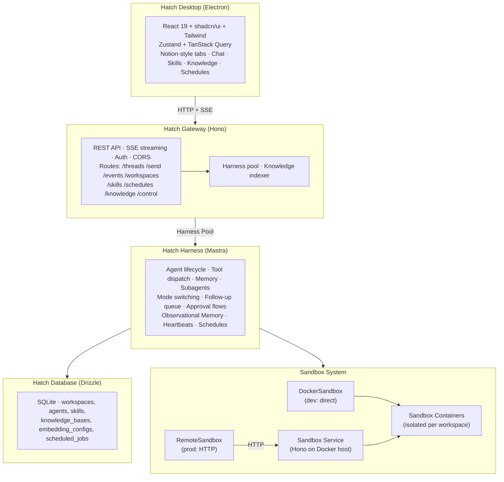
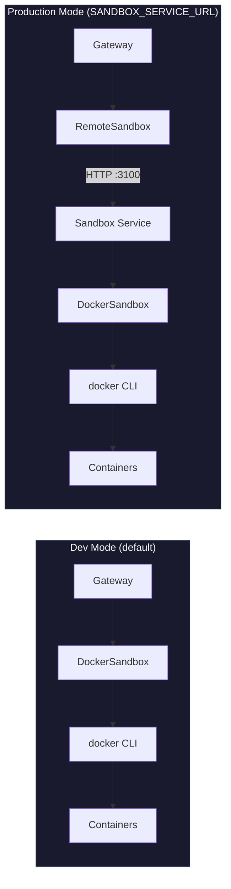

<p align="center">
  
</p>

<h1 align="center">Hatch</h1>

<p align="center">
  <strong>Your agentic workspace, hatched.</strong>
</p>

<p align="center">
  <em>One nest. Many agents. Zero switching.</em>
</p>

<p align="center">
  <a href="#overview">Overview</a> •
  <a href="#why-hatch">Why Hatch</a> •
  <a href="#key-features">Features</a> •
  <a href="#architecture">Architecture</a> •
  <a href="#getting-started">Getting Started</a> •
  <a href="#development">Development</a> •
  <a href="#roadmap">Roadmap</a>
</p>

<p align="center">
  
  
  
  
  
  
</p>

---

## Overview

**Hatch** is a local-first desktop platform for running personal AI agents — each in its own isolated workspace with dedicated memory, tools, schedules, and LLM configuration. No SaaS. No vendor lock-in. Your data stays on your machine.

Instead of juggling fragmented tools (one for chat, another for agents, separate ones for code, marketing, life admin), Hatch gives you a single elegant desktop app where every **workspace** is a fully isolated agent environment. Switch between them like Notion tabs — workspaces, threads, skills, knowledge, schedules, and settings are all one click away in a clean, sidebar-driven layout.

Built on [Mastra AI](https://mastra.ai) for production-grade agent orchestration, using the same harness pattern that powers [MastraCode](https://mastra.ai) (Mastra's coding agent) — handling long-running conversations, observational memory, tool approval, subagents, and self-scheduling — without ever losing context.

---

## Screenshots

<!-- TODO: Add screenshots after UI polish -->
<!-- <p align="center">
  
</p> -->

> Screenshots coming soon — the desktop app is functional with an elegant Notion-inspired UI: chat with streaming, workspace sidebar, skills browser, knowledge file manager, schedules, and settings.

---

## Why Hatch

Building personal AI agents shouldn't mean editing JSON files, losing context between sessions, or running everything in one unsafe environment. Hatch was designed around a simple idea: **every task domain deserves its own workspace.**

| Problem | Hatch Solution |
|---------|----------------|
| Switching between 5+ fragmented tools daily | One elegant desktop app with Notion-style tabs — everything in one sidebar |
| Agents forget everything between sessions | Observational memory — compresses, reflects, never loses context |
| One config for all agents, no isolation | Each workspace has its own LLM, RAG, tools, permissions, and memory |
| Complex CLI/YAML setup to get started | Visual settings, few-click workspace creation from templates, intuitive navigation |
| Agents run with full system access | Sandboxed execution with human-in-the-loop tool approval |
| No way to schedule recurring agent tasks | Built-in RRULE-based schedules, heartbeats, and daily logs per workspace |

### What Makes Hatch Different

- **vs OpenClaw/ClawX** — Not a wrapper around a single agent runtime. Native multi-workspace isolation with per-workspace memory, agents, and config. Built on Mastra's production-grade harness, not bolted on.
- **vs Claude Code / Codex** — Not locked to one provider or limited to coding. Works with any LLM (Claude, GPT, Gemini, Ollama via OpenRouter). Desktop-first with visual config.
- **vs Agent frameworks** — Not just a library. A complete desktop product with UI, gateway server, database, templates, and streaming out of the box.

---

## Key Features

### Workspace Isolation
Each workspace is a fully independent environment — separate agents, LLM provider, API keys, RAG sources, embeddings, tools, MCP servers, permissions, schedules, and memory. Work context never leaks into personal. Marketing never bleeds into code.

### Observational Memory
Three-layer memory system (Actor / Observer / Reflector) that compresses conversation history without naive truncation. The Observer watches and generates dense observations. The Reflector intelligently forgets irrelevant details while preserving key insights. Long conversations stay coherent without blowing up the context window.

### Elegant Desktop UI
Electron app with a refined, Notion-inspired interface — workspace sidebar, tabbed navigation for effortless context switching, floating chat input with backdrop blur, and streaming markdown rendering. Navigate between workspaces, threads, skills, schedules, knowledge bases, and settings without leaving the window. Built with React 19 + shadcn/ui + Tailwind with a custom t3code-inspired theme. Designed to be your daily driver.

### Schedules & Heartbeats
Define recurring agent tasks using RRULE (RFC 5545) — daily competitor monitoring, weekly reports, hourly health checks. Manage schedules directly from the desktop UI with toggle, delete, and per-workspace filtering. Schedule execution worker coming soon.

### Provider Agnostic
Bring any LLM. Claude, GPT, Gemini, Ollama, or any OpenRouter-compatible model. Configure per workspace — your coding workspace can use Opus while your personal assistant runs on a local model.

### Real-Time Streaming
Server-Sent Events from gateway to desktop. Watch agents think, use tools, and respond token by token. 30+ event types: `agent_start`, `tool_call`, `token_usage`, `memory_compress`, `heartbeat`, and more.

### Human-in-the-Loop
Configurable permission rules per workspace. Sensitive tool calls (shell, file write, external API) require explicit user approval before execution. You stay in control.

### Workspace Templates
Start from pre-built templates with full agent personality (SOUL.md + IDENTITY.md) and default skills pre-installed, or create from blank. Workspace creation scaffolds the entire filesystem, database entries, and agent identity in one step.

### Skills Ecosystem
Browse, install, and manage agent skills from the [skills.sh](https://skills.sh) registry — directly from the desktop UI. Skills are installed per workspace (isolated by design) with full CRUD: search, one-click install, uninstall, and view installed skills from the filesystem.

### Knowledge Base
Built-in file manager for per-workspace knowledge — upload documents, organize into folders, preview content, and download files. Uploaded documents are automatically indexed with vector embeddings (chunked with overlap, incremental reindexing via background cron) for RAG retrieval.

---

## Architecture

Hatch is a **monorepo with 8 packages** — clean separation between desktop, gateway, sandbox service, harness, client, database, shared types, and config.



### Sandbox Architecture

The sandbox system supports two deployment modes controlled by a single env var:



Both modes implement the same `MastraSandbox` interface — zero changes to agent, workspace, or tool code. See [`apps/gateway/SANDBOX-DEPLOYMENT.md`](apps/gateway/SANDBOX-DEPLOYMENT.md) for deployment details.

### Design Principles

- **Workspace-first** — Everything is scoped to a workspace. No global state pollution.
- **Process separation** — Gateway runs as a standalone service. Desktop is a thin client. Either can be replaced.
- **Type-safe end-to-end** — Zod validation at every boundary. Hono RPC types flow from server to client.
- **Local-first** — SQLite database, file-based agent identity, no cloud dependency.
- **Portable harness** — The orchestration layer is framework-agnostic. It powers desktop today, can power TUI/web/channels tomorrow.

---

## Getting Started

### Requirements

- **Node.js** v22+
- **Bun** v1.3+

### Install

```bash
git clone https://github.com/user/hatch.git
cd hatch
bun install
```

### Environment

Create a `.env` file at the project root:

```env
OPENROUTER_API_KEY=your-key-here
HATCH_MODEL=openrouter/your-model
HATCH_GATEWAY_TOKEN=your-token
```

### Run

```bash
# Run everything (gateway + desktop)
bun run dev

# Or individually
bun run dev:gateway    # API server on port 3000
bun run dev:desktop    # Electron app with Vite HMR
```

### First Launch

1. The gateway starts on `http://localhost:3000` — the desktop app connects automatically.
2. Create your first workspace from the sidebar.
3. Configure your LLM provider in workspace settings.
4. Start a conversation — your agent is live.

---

## Project Structure

```
hatch/
├── apps/
│   ├── desktop/              # Electron + Vite + React 19 + shadcn/ui
│   │   ├── src/
│   │   │   ├── main/         # Electron main process
│   │   │   └── renderer/     # React app (components, stores, routes)
│   │   └── vite.config.ts
│   ├── gateway/              # Hono HTTP/SSE server
│   │   └── src/
│   │       ├── routes/       # 9 route modules
│   │       ├── services/     # Harness pool, knowledge indexer, DockerSandbox, RemoteSandbox
│   │       └── middleware/    # Auth, CORS, error handling
│   └── sandbox-service/      # Standalone sandbox management service (prod)
│       └── src/
│           ├── routes.ts     # REST API for sandbox lifecycle
│           ├── sandbox-store.ts  # In-memory sandbox registry
│           └── docker-sandbox.ts # DockerSandbox (self-contained)
├── packages/
│   ├── shared/               # Zod schemas, shared types (source of truth)
│   ├── database/             # Drizzle ORM + SQLite (6 tables)
│   ├── harness/              # Mastra-based agent orchestration (4,800+ LOC)
│   ├── client/               # Zustand store + SSE connector + React hooks
│   └── typescript-config/    # Shared tsconfig
├── .resources/               # Vision, progress, identity, research docs
├── package.json              # Bun + Turborepo monorepo root
├── turbo.json                # Task pipeline config
└── .env                      # API keys (not committed)
```

---

## Tech Stack

| Layer | Technology | Purpose |
|-------|-----------|---------|
| Monorepo | Bun 1.3 + Turborepo 2.8 | Fast installs, parallel builds |
| Language | TypeScript 5.9 | Type safety across all packages |
| Desktop | Electron 40 + Vite 7 | Cross-platform app with HMR |
| UI | React 19 + shadcn/ui + Tailwind 4 | Component library + utility CSS |
| State | Zustand + TanStack Query | Client state + server state |
| Server | Hono 4.12 | Lightweight HTTP/SSE gateway |
| Agent | Mastra AI 1.15 | Agent orchestration, tools, memory |
| Database | Drizzle ORM + SQLite | Local persistence, type-safe queries |
| Validation | Zod 4.3 | Runtime schema validation |
| Streaming | Server-Sent Events | Real-time agent events |
| Sandbox | Docker containers | Isolated per-workspace code execution |
| Scheduling | RRULE (RFC 5545) | Durable recurring agent tasks |

---

## Development

### Commands

```bash
# Development
bun run dev               # Run gateway + desktop together
bun run dev:gateway       # Gateway only (port 3000)
bun run dev:desktop       # Desktop only (Electron + Vite HMR)

# Sandbox Service (production — run on Docker host)
cd apps/sandbox-service && bun run dev    # Sandbox service (port 3100)

# Build
bun run build             # Build all packages

# Type checking
bun run typecheck         # TypeScript check across monorepo

# Database
bun run db:generate       # Generate Drizzle migrations
bun run db:migrate        # Run migrations
bun run db:studio         # Open Drizzle Studio (visual DB browser)
bun run db:seed           # Seed initial data
```

### How the Monorepo Works

Turborepo handles the build pipeline. Package dependencies are declared in `turbo.json` — `build` tasks respect the dependency graph, `dev` tasks run in parallel. All packages export TypeScript via `tsup`.

The shared types in `@hatch/shared` are the source of truth — both the gateway (server) and client (desktop) import from the same Zod schemas and type definitions.

---

## Roadmap

### Done
- [x] Monorepo scaffold (7 packages, all building)
- [x] Database schema (6 tables + relations + migrations + seed)
- [x] Agent harness (3,258 LOC — Mastra harness pattern, lifecycle, observational memory, tool approval, subagents, mode switching, follow-up queue)
- [x] Client library (636-line Zustand store, SSE connector with reconnect, React hooks with per-thread selectors)
- [x] Gateway server (9 route modules, harness pool with idle sweep, SSE streaming, Zod validation at every boundary)
- [x] Auth middleware (bearer token, rate limiting, loopback bypass, constant-time comparison)
- [x] Desktop app (Electron + React 19 + shadcn/ui, 50+ components, Notion-style tabs, elegant navigation)
- [x] Chat UI (streaming messages, tool call rendering, markdown, floating input with backdrop blur)
- [x] Skills page (browse from skills.sh, install/uninstall per workspace, infinite scroll)
- [x] Schedules page (list, toggle, delete with DB persistence)
- [x] Knowledge page (file tree, upload with 10MB limit, preview, download, folder creation, move/rename, delete)
- [x] Knowledge base indexing (vector embeddings, chunking with overlap, incremental reindex, 10-min background cron)
- [x] Workspace creation (template scaffolding, SOUL.md + IDENTITY.md generation, default skills installation)
- [x] Sidebar navigation (workspace/thread filtering, active tab tracking, navigation to all pages)
- [x] File-based agent identity (SOUL.md + IDENTITY.md + MEMORY.md per agent)
- [x] Brand identity (8-bit pixel baby dragon mascot)

### Next
- [ ] Schedule execution worker (poll DB, spawn agents on RRULE fire)
- [ ] Settings persistence (model/provider config — UI exists, backend wiring needed)
- [ ] Additional agent templates (Coder, Researcher, Marketing)

### Future
- [ ] Channel integrations (Telegram, Discord, Slack, WhatsApp)
- [ ] TUI client (terminal interface)
- [ ] Web client
- [ ] Skill publishing & marketplace
- [ ] Plugin system
- [ ] Onboarding wizard

---

## Contributing

Contributions welcome — whether it's bug fixes, new features, templates, or docs.

1. **Fork** the repository
2. **Create** a feature branch (`git checkout -b feature/your-feature`)
3. **Commit** your changes with clear messages
4. **Push** to your branch
5. **Open** a Pull Request

Please follow the existing code style (TypeScript strict, Zod validation at boundaries, no `any` types).

---

## Acknowledgments

Hatch is built on the shoulders of great open-source projects:

- [Mastra AI](https://mastra.ai) — Agent orchestration framework and harness pattern (as seen in MastraCode)
- [OpenClaw](https://github.com/OpenClaw) — Inspiration for personal AI agents
- [Electron](https://www.electronjs.org/) — Cross-platform desktop framework
- [Hono](https://hono.dev/) — Lightweight web framework
- [Drizzle ORM](https://orm.drizzle.team/) — Type-safe database toolkit
- [shadcn/ui](https://ui.shadcn.com/) — UI component library
- [Zustand](https://github.com/pmndrs/zustand) — State management

---

## License

Hatch is released under the [MIT License](LICENSE).

---

<p align="center">
  <sub>Built by Amjed from Tunis — for anyone tired of switching between 5 apps to get one thing done.</sub>
</p>
